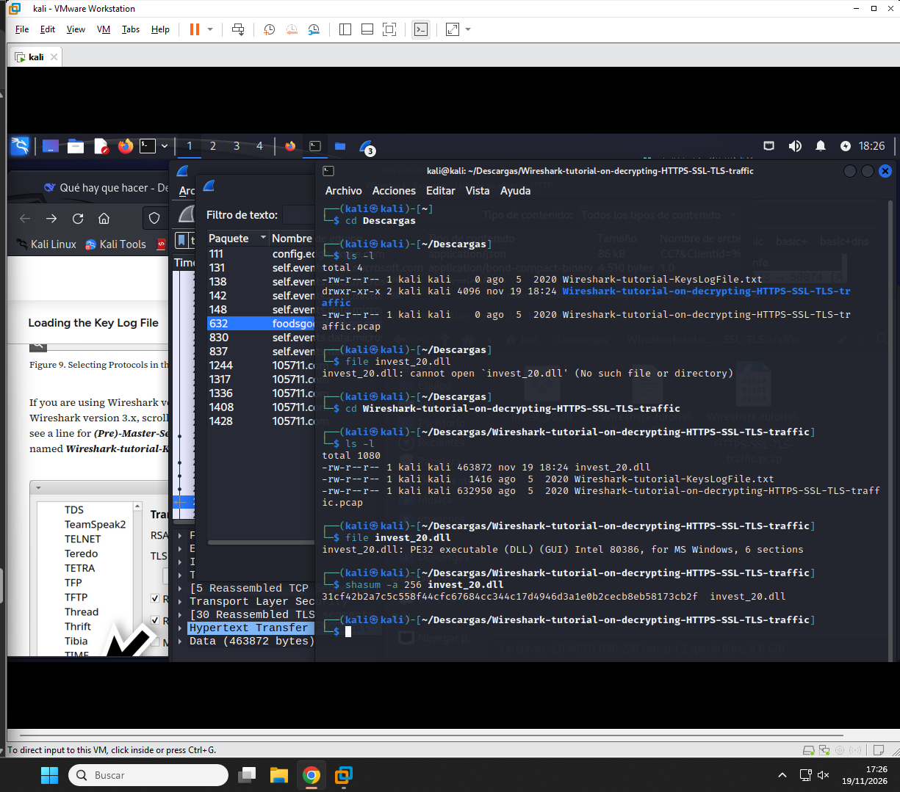
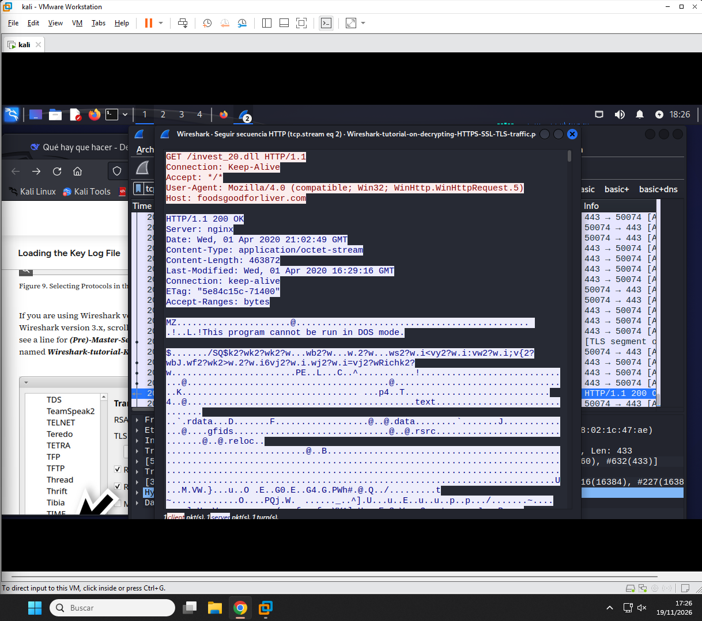

# Wireshark Tutorials – Análisis de Tráfico Malicioso

## Descripción

Este repositorio recoge las actividades realizadas siguiendo la serie de tutoriales de Wireshark de **Unit 42 (Palo Alto Networks)**, enfocadas en el análisis de tráfico de red malicioso generado por malware en entornos Windows.

A lo largo de las actividades se ha trabajado con capturas de tráfico (PCAP) reales de infecciones como Loki Bot, IcedID, Ave Maria RAT, Trickbot y Dridex, aplicando técnicas de personalización, filtrado, identificación de hosts, extracción de objetos y descifrado de tráfico HTTPS.

## Índice

<details>
<summary>Ver actividades</summary>

1. [Personalización de columnas en Wireshark](#actividad-1--personalización-de-columnas-en-wireshark)
2. [Expresiones de filtrado en Wireshark](#actividad-2--expresiones-de-filtrado-en-wireshark)
3. [Identificación de hosts y usuarios](#actividad-3--identificación-de-hosts-y-usuarios)
4. [Exportación de objetos desde un pcap](#actividad-4--exportación-de-objetos-desde-un-pcap)
5. [Descifrado de tráfico HTTPS](#actividad-5--descifrado-de-tráfico-https)
6. [Identificación de Trickbot](#actividad-6--identificación-de-trickbot-no-completada)
7. [Herramientas utilizadas](#herramientas-utilizadas)
8. [Referencias](#referencias)

</details>

---

## Actividad 1 – Personalización de columnas en Wireshark

**Tutorial:** Customizing Wireshark – Changing Your Column Display

**Objetivo:** Configurar una vista de columnas optimizada para el análisis de tráfico web malicioso.

**Pasos realizados:**

- Creación de un perfil de configuración personalizado a partir del perfil por defecto.
- Cambio del formato de hora a UTC (fecha y hora del día) con resolución en segundos.
- Eliminación de las columnas innecesarias (No., Protocol, Length).
- Adición de nuevas columnas: Src port y Dst port (tipo unresolved), y cambio de Source/Destination a direcciones sin resolver.
- Creación de una columna personalizada Host combinando `http.host` y `tls.handshake.extensions_server_name` para visualizar dominios tanto en HTTP como en HTTPS.
- Alineación a la izquierda de las nuevas columnas y ocultación de Src y Src port para centrar la vista en el tráfico web.
- Exportación del perfil de configuración personalizado.

**Captura:**


---

## Actividad 2 – Expresiones de filtrado en Wireshark

**Tutorial:** Using Wireshark Display Filter Expressions

**Objetivo:** Aprender a usar filtros de visualización para investigar tráfico malicioso.

**Pasos realizados:**

- Verificación del perfil personalizado activo.
- Uso de la barra de filtros y comprensión del código de colores:
  - Rojo: filtro inválido.
  - Amarillo: aceptado con advertencias.
  - Verde: filtro válido.
- Estudio de operadores booleanos: `==`, `eq`, `!`, `not`, `&&`, `and`, `||`, `or`.
- Creación de botones de filtro reutilizables:

**Filtro basic:**

```wireshark
(http.request or tls.handshake.type eq 1) and !(ssdp)
```

**Filtro basic+:** añade segmentos TCP SYN para detectar inicios de conexión y conexiones fallidas.

**Filtro basic+dns:** añade consultas DNS para detectar dominios asociados a tráfico no web.

- Aplicación de los filtros a los 5 PCAP del tutorial:

| PCAP | Análisis                                                                                       |
| ---- | ---------------------------------------------------------------------------------------------- |
| 1    | Tráfico de Loki Bot (HTTP POST a `194.55.224[.]9`).                                            |
| 2    | Infección IcedID con dominios `vrondafarih[.]com`, `magiketchinn[.]com` y `magizanqomo[.]com`. |
| 3    | Ave Maria RAT (DNS a `adaisreal.ddns[.]net` → `87.121.221[.]212`, puerto 7888).                |
| 4    | Tráfico FTP malicioso hacia `valvulasthermovalve[.]cl`.                                        |
| 5    | Spambot (SMTP + DNS), análisis de `smtp.req.command` y `smtp.data.fragment`.                   |

**Captura:**


---

## Actividad 3 – Identificación de hosts y usuarios

**Tutorial:** Using Wireshark – Identifying Hosts and Users

**Objetivo:** Identificar el host y el usuario afectados en un PCAP de tráfico comprometido.

**Pasos realizados:**

- Análisis de un PCAP de infección para localizar la IP interna del host infectado.
- Uso de filtros como `nbns`, `kerberos`, `smb` y `dhcp` para extraer información de identificación del host.
- Identificación del nombre de host (hostname) y del usuario a través del tráfico NetBIOS, Kerberos o SMB.
- Uso de la opción Follow → TCP Stream y del apartado de detalles del frame para revisar los campos relevantes.
- Correlación de la IP del host infectado con el usuario y el nombre del equipo comprometido.
- Documentación del host y usuario afectados como parte del proceso de respuesta a incidentes.

**Captura:**


---

## Actividad 4 – Exportación de objetos desde un pcap

**Tutorial:** Using Wireshark – Exporting Objects from a pcap

**Objetivo:** Extraer archivos y objetos transmitidos en el tráfico de red para su análisis.

**Pasos realizados:**

**HTTP:**

- Exportación de objetos con `File → Export Objects → HTTP...`:
  - `Invoice&MSO-Request.doc` y `knr.exe` del tráfico a `smart-fax[.]com`.
  - Página de phishing de PayPal desde el segundo PCAP.
- Verificación de los archivos exportados con `file` y `shasum -a 256` en Linux.

**SMB:**

- Exportación de ejecutables Trickbot transmitidos vía SMB en un entorno Active Directory (`cliffstone[.]net`).
- Verificación del campo Content Type al 100% para asegurar copias íntegras.

**SMTP:**

- Exportación de correos con `File → Export Objects → IMF...` (archivos `.eml`).
- Visualización de los correos en Thunderbird (spam de sextorsión).

**FTP:**

- Exportación con `File → Export Objects → FTP-DATA...` de archivos HTML exfiltrados.
- Para los ejecutables (`q.exe`, `w.exe`, `e.exe`, `r.exe`, `t.exe`) se utilizó el filtro:

```wireshark
ftp-data.command contains ".exe" and tcp.seq eq 1
```

- Seguimiento del stream TCP y guardado de los datos en formato Raw.

**Captura:**


---

## Actividad 5 – Descifrado de tráfico HTTPS

**Tutorial:** Wireshark Tutorial – Decrypting HTTPS Traffic

**Objetivo:** Descifrar tráfico HTTPS en un PCAP utilizando un archivo de log de claves.

**Pasos realizados:**

- Comprensión del contexto: HTTPS = túnel cifrado (SSL/TLS) que contiene HTTP.

- Carga del archivo de claves `Wireshark-tutorial-KeysLogFile.txt` mediante:

  `Edit → Preferences → Protocols → TLS → (Pre)-Master-Secret log filename`

- Con el filtro básico aplicado, observación de las peticiones HTTP descifradas bajo cada línea HTTPS.

- Identificación del tráfico de la infección Dridex:

  - `foodsgoodforliver[.]com` – `GET /invest_20.dll` (descarga del binario malicioso).
  - `105711[.]com` – `POST /docs.php` (tráfico C2).

- Exportación del malware con `File → Export Objects → HTTP...`.

- Verificación del archivo exportado con `file` y `shasum -a 256`.

**SHA256 del malware:**

```text
31cf42b2a7c5c558f44cfc67684cc344c17d4946d3a1e0b2cecb8eb58173cb2f
```

En las capturas se muestra el proceso completo:

- Descarga y extracción del ZIP con la contraseña `infected`.
- Apertura del PCAP en Wireshark.
- Carga del archivo de claves en las preferencias de TLS.
- Visualización del tráfico descifrado.
- Verificación del DLL exportado (`invest_20.dll`) mediante `file` y `shasum -a 256`, confirmando que se trata de un ejecutable PE32 para Windows.

**Capturas:**




---

## Actividad 6 – Identificación de Trickbot (no completada)

**Tutorial:** Wireshark Tutorial – Examining Trickbot Infections

**Objetivo:** Identificar una infección por Trickbot mediante el análisis de sus patrones de tráfico.

**Estado:** No completada.

**Motivo:**

Al intentar extraer el PCAP del archivo ZIP proporcionado en el tutorial, la contraseña indicada (`infected`) no era la correcta, por lo que no fue posible acceder a la captura y realizar el análisis correspondiente.

**Prueba:**

Se adjunta un vídeo donde se muestra el intento de extracción del ZIP y el error de contraseña.

**Vídeo de prueba:** 

**Captura:**
**Vídeo de prueba:** [Ver vídeo de la actividad 6](video/6.mp4)


---

## Herramientas utilizadas

- **Wireshark (v4.x):** análisis de tráfico de red.
- **Kali Linux:** entorno de trabajo para realizar las actividades de forma segura.
- **file:** identificación del tipo de archivo.
- **shasum -a 256:** cálculo del hash SHA256.
- **unzip:** extracción de archivos ZIP.
- **Navegador web:** consulta de los tutoriales.
- **Editor de texto:** revisión de objetos exportados.

## Referencias

- [Unit 42 – Wireshark Tutorials (Palo Alto Networks)](https://unit42.paloaltonetworks.com/wireshark-tutorials/)
- [Repositorio oficial de PCAP – pan-unit42/wireshark-tutorials](https://github.com/pan-unit42/wireshark-tutorials)
- https://unit42.paloaltonetworks.com/unit42-customizing-wireshark-changing-column-display/
- https://unit42.paloaltonetworks.com/using-wireshark-display-filter-expressions/
- https://unit42.paloaltonetworks.com/using-wireshark-identifying-hosts-and-users/
- https://unit42.paloaltonetworks.com/using-wireshark-exporting-objects-from-a-pcap/
- https://unit42.paloaltonetworks.com/wireshark-tutorial-decrypting-https-traffic/
- https://unit42.paloaltonetworks.com/wireshark-tutorial-examining-trickbot-infections/
